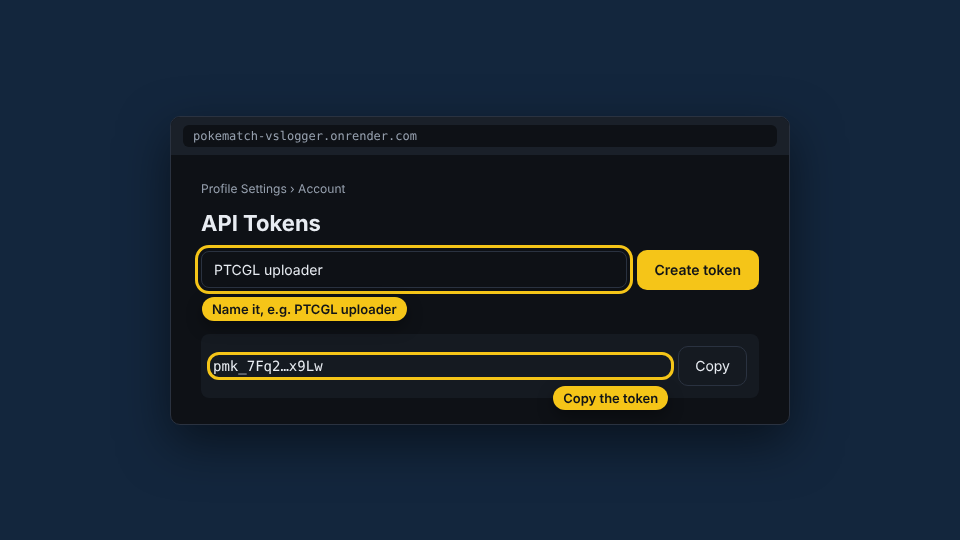
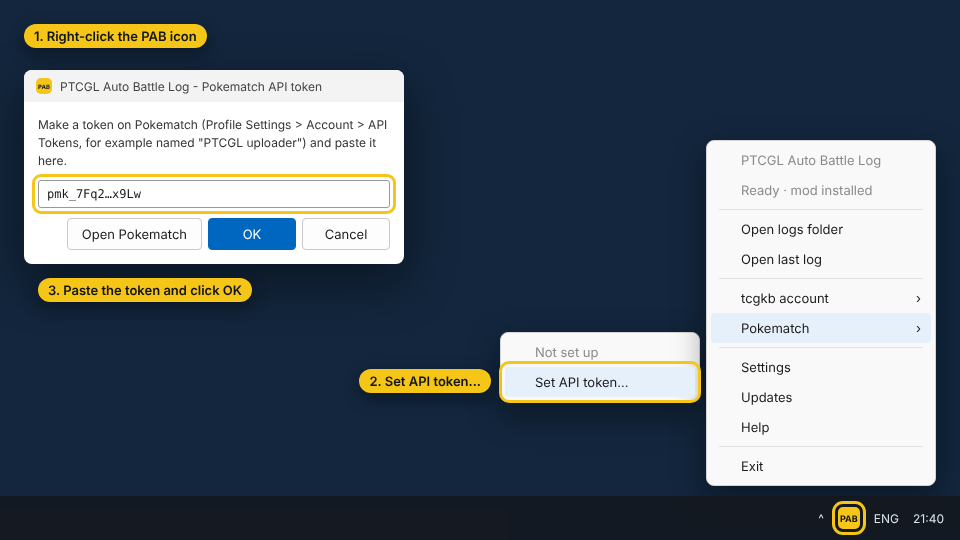
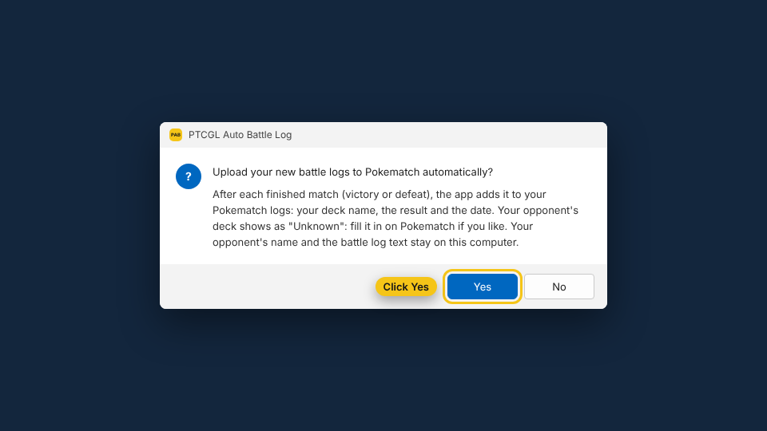
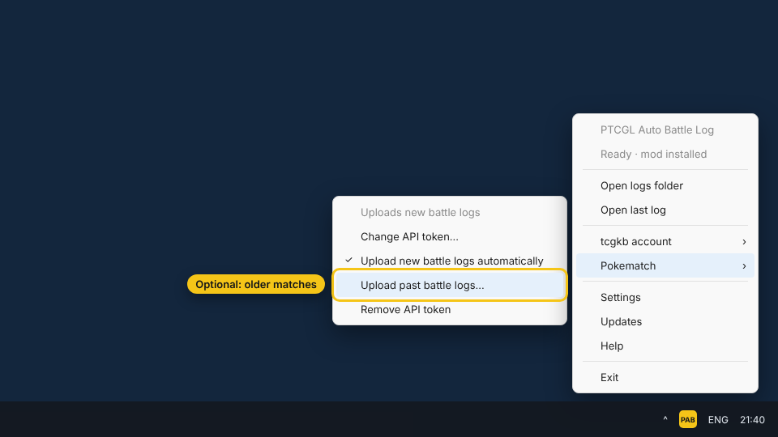
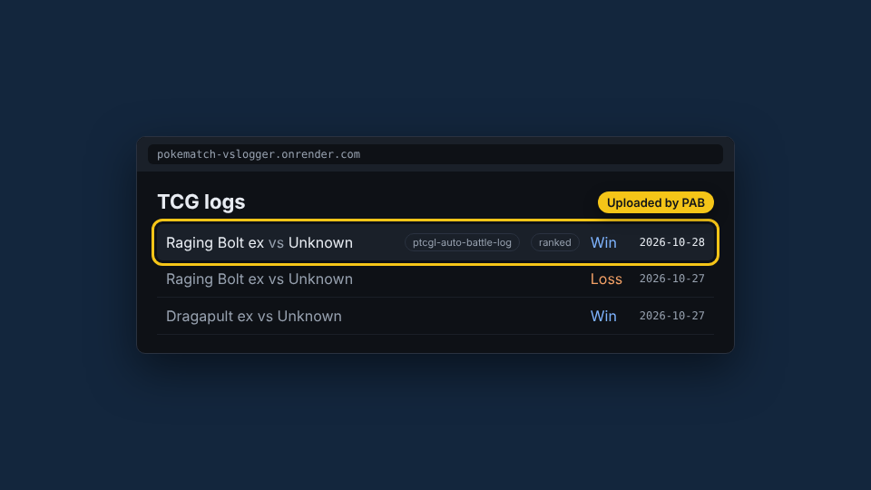

<!-- Written by tools/quick-setup/make_pages.py from steps.json: edit steps.json, then run it. -->

# Upload your matches to Pokematch

Install PAB, give it a Pokematch API token and every match you finish is added to your Pokematch logs on its own.

Other guides: [Install PAB](install.md), [Get started in 5 minutes](tcgkb.md). Every guide is also in 8 more languages in [steps.json](steps.json).

## 1. Make a Pokematch API token

*On the web*

Sign in to Pokematch and open Profile Settings › Account › API Tokens. Create a token, for example named “PTCGL uploader”, and copy it.

> Changing your Pokematch password revokes every token: then make a new one and set it again in PAB.

[Open Pokematch](https://pokematch-vslogger.onrender.com/)

## 2. Download PAB and open it

*On your PC*

Download PtcglAutoBattleLog.exe and double-click it. Windows may show a blue warning because the app is new: click “More info”, then “Run anyway”.

> Don't run it as administrator: PAB installs for your user only.

[Download PAB for Windows](https://github.com/manucruzleiva/ptcgl-auto-battlelog/releases/latest/download/PtcglAutoBattleLog.exe)

## 3. Accept the notice and install

PAB tells you what it does and what it sends. Click “I understand, install”. A yellow icon appears next to the Windows clock.

> If you can't see the icon, look under the ^ arrow in the taskbar.

## 4. Play a match in PTCGL

Open Pokémon TCG Live and play any match. When it ends you get a “battle log saved” notification: PAB is saving your matches.

> If the game was open while you installed, close it and open it again.

## 5. Paste the token into PAB

*Connect*

Right-click the PAB icon, open “Pokematch” and choose “Set API token...”. Paste the token and click “OK”.

> The token is kept encrypted on this PC for your Windows user and is sent only to Pokematch.

## 6. Turn on automatic upload

PAB asks “Upload your new battle logs to Pokematch automatically?”. Click “Yes”. From now on every finished match is added to your Pokematch logs: your deck, the result and the date.

> Your opponent's deck shows as “Unknown”: fill it in on Pokematch if you like. Your opponent's name and the log text stay on your PC.

## 7. Send your older matches (optional)

In the same menu, “Upload past battle logs...” sends the matches already in your logs folder. Matches Pokematch already has are not sent again.

## 8. Done! Check your Pokematch logs

*Done*

Play a match and open your TCG logs on Pokematch: the match shows up with the tag “ptcgl-auto-battle-log”.

> To stop uploading, untick “Upload new battle logs automatically” or choose “Remove API token” in the Pokematch menu.

[Open Pokematch](https://pokematch-vslogger.onrender.com/)
