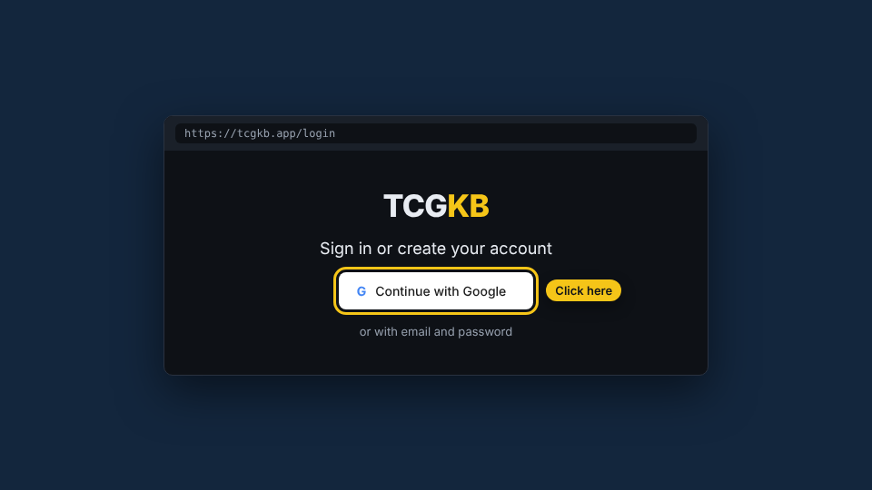
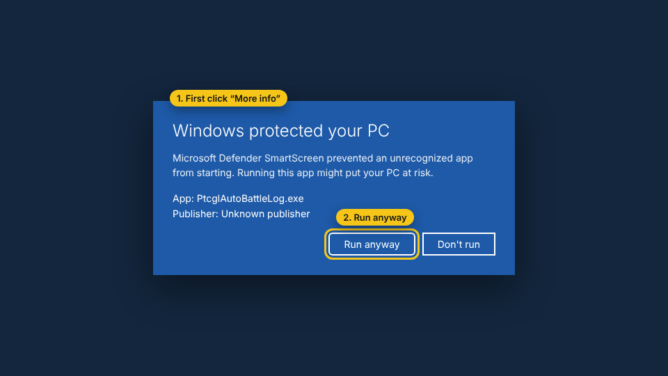
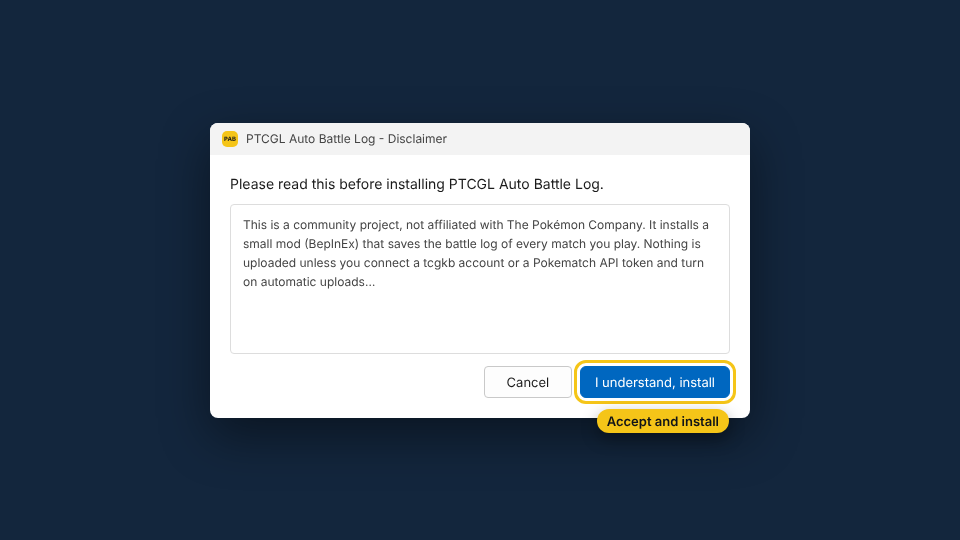
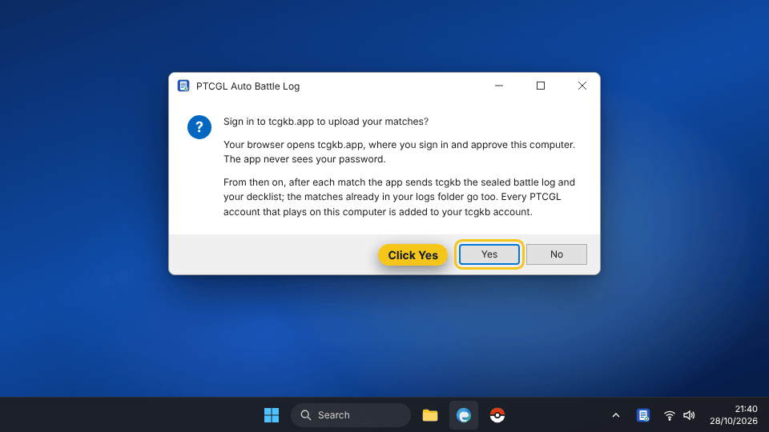
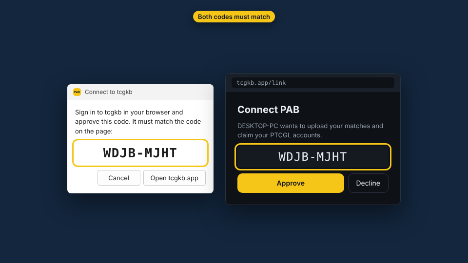
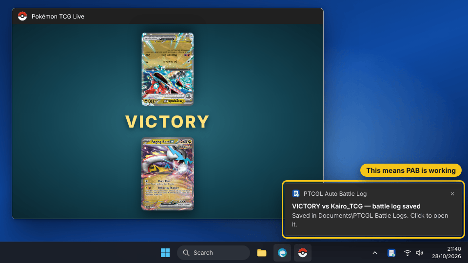
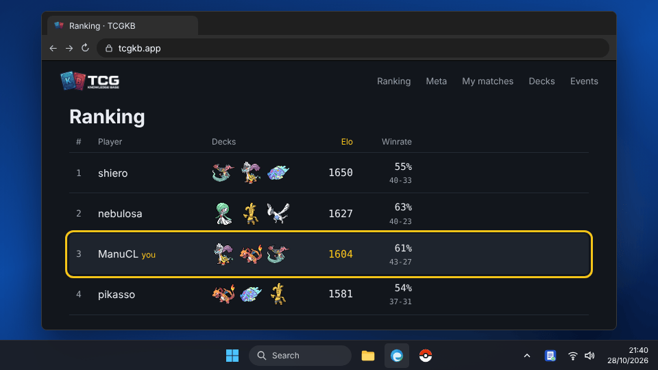

<!-- Written by tools/quick-setup/make_pages.py from steps.json: edit steps.json, then run it. -->

# Get started in 5 minutes

Install PAB, sign in once and your PTCGL matches upload to the ranking on their own.

Other guides: [Install PAB](install.md), [Upload your matches to Pokematch](pokematch.md). Every guide is also in 8 more languages in [steps.json](steps.json).

## 1. Create your TCGKB account

*On the web*

Sign up with Google or email. Only players with an account show up in the ranking.

[Create account](https://tcgkb.app/register)

## 2. Download PAB and open it

*On your PC*

Download PtcglAutoBattleLog.exe and double-click it. Windows may show a blue warning because the app is new: click “More info”, then “Run anyway”.

> Don't run it as administrator: PAB installs for your user only.

[Download PAB for Windows](https://github.com/manucruzleiva/ptcgl-auto-battlelog/releases/latest/download/PtcglAutoBattleLog.exe)

## 3. Accept the notice and install

PAB tells you what it does and what it sends. Click “I understand, install”. A yellow icon appears next to the Windows clock.

> If you can't see the icon, look under the ^ arrow in the taskbar.

## 4. Sign in to TCGKB from PAB

*Sign in*

Right after installing, PAB asks “Sign in to tcgkb.app to upload your matches?”: click “Yes” and your browser opens. That is the only setup: automatic uploads are already on, and every PTCGL account you play with on this PC is added to your account.

> Closed it? Right-click the PAB icon, open “tcgkb account” and choose “Sign in to tcgkb...”.

## 5. Approve the code on tcgkb.app

PAB shows a code and tcgkb.app shows another. If they match, click “Approve”. PAB never sees your password.

> You can disconnect this PC any time from your profile.

## 6. Play a match in PTCGL

Open Pokémon TCG Live and play any match. When it ends you get a “battle log saved” notification: PAB is saving your matches.

> If the game was open while you installed, close it and open it again.

## 7. Done! You're playing for the ranking

*Done*

After 5 matches you show up in the ranking with your Elo, winrate and 3 most played decks. My matches shows your matchups.

> Your account is verified once another TCGKB player uploads a match against you.

[See my matches](https://tcgkb.app/matches)
